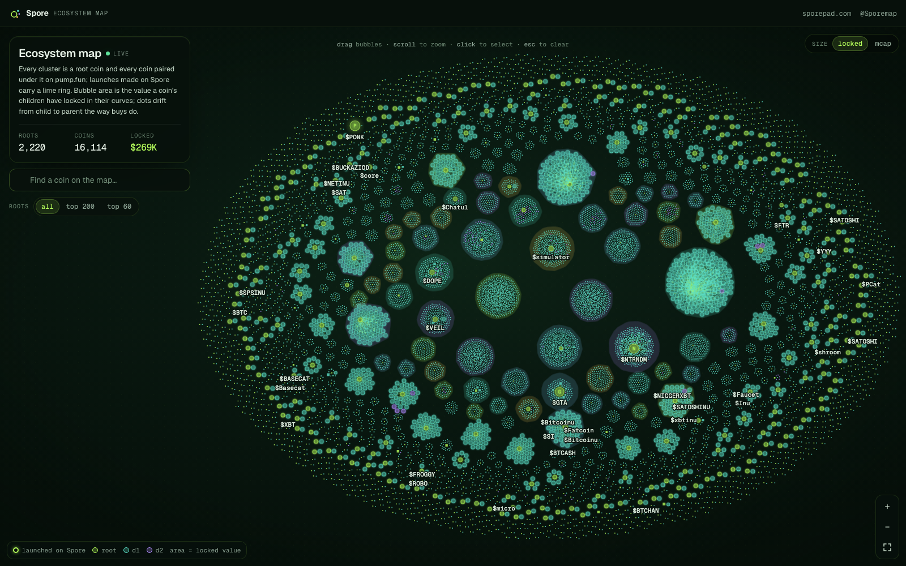

# Spore ecosystem map

The whole pump.fun custom-pair ecosystem as one live bubble map. Every cluster is a **root coin** (a pump.fun coin that other coins were paired under) and every bubble inside it is a coin quoted in that root or in one of its descendants. Bubble area is the value a coin's children have locked in their curves (or its market cap), links run child → parent, and dots drift along them the way buys do: every buy of a child buys its parent first. Coins launched on [Spore](https://sporepad.com) carry a lime ring.

**Live:** https://sporepad.com/map · **This repo, deployed:** https://sporemap.github.io/spore-map/ · **Data:** the public Spore API (documented below) · **Licence:** MIT



This repository is the map extracted from the Spore web app as a standalone page **and** a React component, so you can embed it, fork it, re-theme it or build something else on the same data. It is a d3-force layout in a Web Worker drawn on a single canvas, with an IndexedDB cache and delta sync, holding ~16 k coins at 60 fps.

- 2,200+ root clusters, 16,000+ coins, drawn in full (the roots control narrows to the top 200 / 60)
- Pan, zoom, drag bubbles, hover for names and numbers, click for a side panel, search, `?focus=<mint>` deep links
- Labels for every bubble ≥ 9 px on screen, logos loaded lazily by visibility
- Live: new pairs pulse in over SSE, numbers tween as trades land, the dot in the panel shows the stream status
- Warm opens paint the last settled layout from IndexedDB in well under a second, then fetch only what changed
- No wallet, no Solana dependencies, no server: React 19 + d3 7 + Vite 8, TypeScript

## Quick start

```sh
git clone <this repo> spore-map && cd spore-map
npm install
npm run dev          # http://127.0.0.1:5260 — /api is proxied to https://sporepad.com (no CORS needed)
npm run build        # dist/ — a static page that calls https://sporepad.com directly
npm run preview      # serves dist/ on :5261, proxying /api like the dev server (for a VITE_API_BASE= build)
npm run typecheck
npm run build:lib    # dist-lib/ — the component as an ES module (+ .d.ts, CSS, worker asset)
```

Node 20+ (developed on 25). The dev server needs no configuration: Vite proxies `/api/*` to the public Spore API so the page runs same-origin. A production build calls the API by absolute URL; set `VITE_API_BASE` at build time to point it elsewhere (an empty value means "same origin", for a deployment that proxies `/api` itself):

```sh
VITE_API_BASE=https://sporepad.com npm run build   # the default
VITE_API_BASE= npm run build                        # same-origin /api (npm run preview, or your own proxy)
```

### Cross-origin note

The Spore API sends CORS headers only to origins on its allowlist. `https://sporemap.github.io` is allowed (that is what the deployed demo uses); a build served from your own host can reach `https://sporepad.com/api/*` only once your origin is allowed too — ask on X (@Sporemap) — or proxy the API through your own server, as `vite.config.ts` does in development.

### Deploying to GitHub Pages

`.github/workflows/pages.yml` builds `dist/` and publishes it with `actions/deploy-pages` on every push to `main`. Enable Pages for the repository (Settings → Pages → Source: *GitHub Actions*). The build uses `base: "./"`, so it works under `https://<user>.github.io/<repo>/`. Set a repository variable `VITE_API_BASE` to change the API host. See the cross-origin note above: the published page needs its origin allowed on the API, or a proxy.

## Embedding the component

```tsx
import { SporeMap } from "spore-map";          // or "./src/lib" when vendoring this repo
import "spore-map/style.css";                  // the component's own styles (scoped to .bm)

export function Page() {
  return (
    <SporeMap
      apiBase="https://sporepad.com"          // default; "" = same-origin /api
      height={640}
      roots="all"                              // "all" | 200 | 60
      mode="locked"                            // "locked" (value locked by children) | "mcap"
      onSelect={(node) => console.log(node?.mint)}
    />
  );
}
```

Peer dependencies: `react` ^19, `react-dom` ^19, `d3` ^7. The library bundle (`npm run build:lib`) is one ES module plus `spore-map.css` and `assets/layout.worker-*.js`; the worker is referenced with `new URL("assets/…", import.meta.url)`, which Vite, webpack 5 and plain ESM resolve next to the module (keep `assets/` next to `spore-map.js` when you copy the files by hand). The component declares its colour and font tokens on `.bm` (see `src/map.css`), so it looks the same inside any page; override them to re-theme. The fonts it asks for are *Geist* / *Geist Mono* (Google Fonts, see `index.html`) with system fallbacks.

`<SporeMap>` props:

| Prop | Type | Default | Meaning |
|---|---|---|---|
| `apiBase` | `string` | `"https://sporepad.com"` | Origin of the Spore API. `""` for a same-origin `/api`. |
| `roots` | `"all" \| 200 \| 60` | `"all"` | Draw everything, or only the subtrees of the top-n roots by locked value. |
| `mode` | `"locked" \| "mcap"` | `"locked"` | What bubble area means. The size toggle in the corner changes it; `onModeChange` reports it. |
| `select` / `onSelect` | `string \| null` / `(node \| null) => void` | — | Controlled selection by mint. With `onSelect` set, a click selects (the camera glides there) instead of pinning the tooltip; Esc or an empty click gives `null`. |
| `height` | `number \| string` | `600` | CSS height of the map. |
| `inset` | `{ left?, top?, right?, bottom? }` | — | Screen area your overlays cover, so *fit* centres the bubbles in what is visible. |
| `ref` | `Ref<BubbleMapHandle>` | — | `fit()`, `focusNode(mint)`, `frameStats()`. |
| `onData` | `(d: MapData) => void` | — | Data state for your own counters: `nodes`, `total`, `source` (`"cache"` / `"network"`), `loading`, `syncing`, `error`, `reload()`. |
| `className` | `string` | — | Added to the root `.bm` element (`bm-full` removes the rounded corners). |

Lower-level pieces are exported too, for a different UI on the same data: `useMapData({ apiBase })` (cache + delta + live events → `BubbleNode[]`), `BubbleMap` (the canvas alone, takes `nodes`), `createApi(apiBase)` (typed fetchers), `useEvents` / `useStreamStatus` (the shared SSE connection), `viewOf(nodes, limit)`, `normalise` / `applyDelta` / `applyPair` (wire shapes → nodes), the formatters and the types. `src/App.tsx` is a complete example: the demo page with its stats panel, search, roots control and side panel.

## Public API

Base URL `https://sporepad.com`. Everything is JSON over GET; errors are `{ "error": "…" }` with a 4xx/5xx status. Responses carry weak ETags and `Cache-Control: public, max-age=3–10, stale-while-revalidate` (send `If-None-Match` for a 304) and are gzip/brotli compressed. The server is the Spore indexer: it follows pump.fun's on-chain program, so "every pump.fun pair" means every coin whose quote is another pump coin (depth ≥ 1) plus the roots they hang from.

**Rate limits**, per client IP, with `X-RateLimit-Limit` / `-Remaining` / `-Reset` / `-Policy` headers and `429 { error, retryAfter }` + `Retry-After` when exceeded:

| Lane | Limit | Covers |
|---|---|---|
| `api` | 300 per minute | `/api/map`, `/api/stats`, `/api/coin/*` and every other JSON route |
| `img` | 900 per minute | `/api/img` |
| `sse` | 30 new connections per minute, 5 open streams per IP, 2 000 in total | `/api/events` (503 when the global cap is reached; a client that stops reading is cut at 256 KB buffered) |

The map needs very little of that: one `/api/map` call per open (≈ 1.3 MB gzip for the full forest, a few KB for a delta), a delta every 2 minutes, one SSE stream, and images only for bubbles big enough to show a logo (≤ 8 in flight).

### `GET /api/map?scope=all&limit=all[&since=<ms>][&depth=<n>]` — the forest

| Param | Values | Meaning |
|---|---|---|
| `scope` | `all` | Every pump.fun pair the indexer knows. **Without it** the route lists only coins launched on Spore (the launchpad's default listing mode). |
| `limit` | `all` | The whole forest: every root with at least one child and every descendant, no fan-out cap. Roots and children are ordered by locked value, largest first. Built at most once per 10 s and shared by every client. |
| `limit` | `1`–`200` (default 60) | The top-n roots by locked value, each with children and grandchildren (`depth` 0–4, default 2; `fanout` 1–200, default 40, caps the children per node). The response has no `version` / `generatedAt` / `total` in this form. |
| `since` | unix **milliseconds** | With `limit=all`: only the nodes whose `updated_at` moved after that instant, flat. Use the `generatedAt` of your last full or delta response. |
| `depth` | `0`–`6` | With `limit=all`: how deep to descend; the default is the program's depth cap (currently 2 = everything), so leave it out. |

Full form (`roots` is a tree):

```jsonc
{
  "roots": [ { "coin": MapCoin, "children": [ { "coin": MapCoin, "children": [] } ] } ],
  "scope": "all",
  "version": 196627,            // bumps whenever the indexer's model changed
  "generatedAt": 1792394565937, // ms; pass it back as since=
  "total": 16110                // nodes in the tree
}
```

Delta form (`since=`): the changed nodes as a flat list, each with its `parentMint` (`null` for a root). Only nodes the full map would draw are included (a root with children, or a child whose parent chain reaches a tracked root), largest locked value first; cached 10 s per `since` value. `removed` is reserved (coins are never deleted). `total` is the size of the full forest right now, so a client can tell a stale cache from a complete one.

```jsonc
{ "nodes": [ { ...MapCoin, "parentMint": "…" | null } ], "removed": [], "generatedAt": 1792394569460, "total": 16110, "version": 196627 }
```

What moves `updated_at` (and therefore lands in a delta): a new coin, reserves / complete / migrate / pool balances (trades and refresh ticks), a sharing config (`ours`), an on-chain name/ticker/uri that resolved, an off-chain image that resolved, a child's reserve or migration change (it stamps the parent: locked value, child count). What does **not**: price moves inherited from an ancestor or from SOL/USD; the live `mapdelta` event carries those for the traded coins.

**`MapCoin`** — one node:

| Field | Type | Meaning |
|---|---|---|
| `mint` | `string` | The coin's mint address (base58). |
| `name`, `symbol` | `string \| null` | On-chain metadata (present for 99.9 % of mints). |
| `image` | `string \| null` | A path on the API host, `/api/img?u=<encoded upstream URL>`, or `null` until the off-chain metadata resolved. Prefix it with the API origin. |
| `depth` | `number` | `0` = root (quoted in SOL / a listed mint), `1` = quoted in a root, … |
| `ours` | `boolean` | Launched through Spore (Spore's platform share is in the coin's on-chain fee split). The lime ring. |
| `oursPending` | `boolean` | Reported as a Spore launch by the UI, verification on-chain still pending. |
| `mcapUsd` | `number \| null` | Market cap in USD (price × total supply), `null` when no price is known yet. |
| `lockedUsd` | `number \| null` | USD value of this coin held in its children's bonding curves (what the default bubble size shows). |
| `children`, `descendants` | `number` | Direct children, and the whole subtree. |
| `otherChildren` | `number` | Children that exist on pump.fun but were not launched on Spore (0 with `scope=all`). |
| `migrated` | `boolean` | Bonding curve complete and migrated to PumpSwap ("graduated"). |
| `createdAt` | `number \| null` | Unix **seconds** of the create transaction, when known. |
| `parentMint` | `string \| null` | Delta form only: the parent's mint. In the tree form the parent is the node above. |

### `GET /api/stats` — global counters

```jsonc
{
  "coins": 16, "roots": 3, "byDepth": [7, 8, 1],      // the launchpad's listing (Spore launches only)
  "lockedUsd": 1650.79, "volume24hUsd": 99791.63, "solUsd": 105.67,
  "maxDepth": 2,                                      // the program's depth cap: a coin at this depth cannot be a parent
  "backfill": { "done": true, "total": 13411, "resolved": 13411, "failed": 0 },
  "updatedAt": 1792394564,                            // unix seconds
  "mode": "ours", "ourCoins": 16, "otherChildren": 0
}
```

Note that `coins` / `roots` / `lockedUsd` count the launchpad's own coins; the map computes its counters from the forest it draws. The same object is pushed as the SSE `stats` event.

### `GET /api/coin/<mint>` — one coin in full

`{ "coin": Coin, "children": Coin[], "trades": Trade[], "otherChildren": number }` — children sorted by locked value, the latest trades. A pump coin the index has not seen yet is fetched live (404 for anything that is not a pump coin, 400 for a malformed mint). On the public server `children`, `descendants` and `lockedUsd` of this record count only coins launched on Spore (the launchpad's listing mode) and `otherChildren` the rest of the pump.fun children, so for ecosystem-wide numbers use the map's node, as the side panel does. The side panel reads: `name`, `symbol`, `image`, `depth`, `parent` / `root` / `ancestors` (`CoinRef`s: `{ mint, name, symbol, image, depth }`, `parent` and `root` are `null` on a root), `complete`, `migrated`, `createdAt`, `mcapUsd`, `lockedUsd`, `progress` (0–1 of the curve filled), `children`, `descendants`, `volume24hUsd`, `trades24h`, `ours`, `oursPending`, `mayhem` (pump's mayhem mode: such a coin cannot be a parent). The full record also carries `description`, `twitter`, `telegram`, `website`, `creator`, `quoteMint` (`null` = SOL), `quoteSymbol`, `quoteDecimals`, `pool`, `createdSlot`, `tokenProgram`, `decimals`, `totalSupply` (raw integer string), `priceQuote`, `priceSol`, `priceUsd`, `mcapSol`, `lockedQuote` (raw integer string), `holderReward`, `creatorFeeBps`, `shares` (`[{ address, bps }]` of the fee split), `curve`, `tracked`, `feePaid`, `updatedAt` (unix **seconds** here, unlike the map's millisecond stamps).

`Trade`: `{ sig, mint, slot, time (unix s), isBuy, user, baseAmount (raw string), quoteAmount (raw string), priceQuote, priceUsd | null, valueUsd | null }`.

### `GET /api/img?u=<url>` — image proxy

A cached proxy (4 MB cap, 24 h) for the images the API itself hands out: the `image` of an indexed coin or a file on Spore's metadata host. Any other URL is 404, even on an allowed host, so always use the `image` value as given rather than building your own. IPFS URIs are resolved through a gateway rotation server-side. Served with the sniffed content type; 900 per minute per IP.

### `GET /api/events` — Server-Sent Events

One stream, `text/event-stream`, with a `: connected` comment on open and a heartbeat comment every 15 s. Events:

| Event | Payload | When |
|---|---|---|
| `pair` | `{ "coin": MapCoin, "parent": MapCoin }` | A coin the live stream created whose parent is tracked (depth ≥ 1), and again when a known child's parent becomes known. `parent` lets a client add a root it has not drawn yet. Deduped per mint for 60 s. |
| `mapdelta` | `{ "at": ms, "updated": [ { "mint", "mcapUsd", "lockedUsd", "children", "descendants", "migrated", "name"?, "symbol"?, "image"? } ] }` | Flushed every 3 s when something changed, at most 500 entries per batch (largest locked value first; the rest wait for the next flush). Numbers that moved from trades, refresh ticks and completions, plus late-resolved names and logos. |
| `stats` | the `/api/stats` object | Every refresh tick (~30 s). |
| `coin` | `Coin` | A new coin launched on Spore (the launchpad's own feed; `pair` already covers it for the map). |
| `trade` | `Trade` | Every trade the live stream sees. |

The client in `src/map/events.ts` keeps one `EventSource` per URL, reconnects with exponential backoff (1 s → 30 s, jittered), and resets the backoff when the tab becomes visible again. After a reconnect the data hook re-asks `since=<generatedAt>` for the span it may have missed.

## How the map works

- **Data** (`src/map/use-map-data.ts`, `nodes.ts`, `cache.ts`): on mount the IndexedDB cache (nodes + last layout positions + `generatedAt`) is rendered at once; then `GET /api/map?scope=all&limit=all&since=<generatedAt>` merges the delta. A cold cache does one full load. `pair` / `mapdelta` events patch the same set, every change is written back (chunked, 2 s debounced), and a resync runs every 2 minutes. Unchanged nodes keep their object identity, which is what lets the map diff 16 k nodes in a millisecond instead of restarting. The cache is one database per API base; `CACHE_V` bumps clear it.
- **Layout** (`src/map/layout.worker.ts`): d3-force in a Web Worker. The page sends typed arrays once (positions, radii, cluster centres, parent links) and gets positions back as transferred `Float32Array`s; buffers are returned after each frame, so steady state allocates nothing on either side. Forces: links to the parent, a short-range charge, collision with padding, and a pull toward the root's cluster centre. Clusters are placed once with `d3.packSiblings` (one circle per root); a root that arrives later gets a spot on the periphery, never a re-pack. New nodes are placed next to their parent and relaxed with a low alpha; changed values tween radius; the simulation is never restarted. The worker is created with `new Worker(new URL("./layout.worker.ts", import.meta.url), { type: "module" })`, so Vite bundles it as its own chunk.
- **Store** (`src/map/store.ts`): structure-of-arrays. `x/y/r` in `Float32Array`s, flags/colour/depth in byte arrays, draw order as an `Int32Array` sorted by radius, CSR child lists for hover highlighting, hull polygons of the 60 largest clusters in preallocated arrays. The draw loop interpolates between the last two worker frames, so a 50 ms worker tick still moves bubbles at 60 fps.
- **Draw** (`src/map/draw.ts`, `sprites.ts`): one canvas, offscreen culling, three tiers by on-screen radius: specks batched into a few `Path2D` fills, shared sprites per colour + size, per-node sprites with the glow baked in and the logo once it loads. Links are batched per colour and skipped into specks; labels are cached bitmaps for every bubble ≥ 9 px (overlap-culled, cap 160, the 36 biggest always named); the dotted ground is a fill pattern. Only the hovered, selected and focused bubbles take the slow path. Zero per-node allocation per frame.
- **Images** (`src/map/images.ts`): logos load lazily by visibility and zoom through `/api/img`, ≤ 8 in flight, newest wants first, with a failed set so a 404 is never retried; a bubble shows its letter until the logo arrives and swaps without a flicker.
- **Budget** the original was built to: ≤ 16 ms per frame settled, ≤ 33 ms while settling, at 20 k nodes in headless Chrome with software rasterisation; warm first paint < 500 ms. `window.__sporeMap` (dev, or `?debug` on a build) exposes `frameStats()`, `nodes()`, `settled()` and friends for measuring.

## Repository layout

```
index.html, src/main.tsx      the demo page entry (VITE_API_BASE → apiBase)
src/App.tsx, src/app.css      the page: stats panel, search, roots control, side panel, top bar
src/lib.ts                    library entry (SporeMap + the pieces)
src/map.css                   the component's styles (tokens scoped to .bm)
src/map/SporeMap.tsx          data + canvas in one component
src/map/BubbleMap.tsx         the canvas: store diffing, worker protocol, zoom/drag/hover, controls, legend
src/map/draw.ts, sprites.ts   the per-frame draw and the bitmap caches
src/map/store.ts              structure-of-arrays store, clusters, hulls
src/map/layout.worker.ts      d3-force off the main thread
src/map/use-map-data.ts       cache → delta → live events
src/map/nodes.ts              wire shapes → BubbleNode, merging, root views
src/map/cache.ts              IndexedDB
src/map/images.ts             bounded logo loader
src/map/api.ts, events.ts     typed API client, shared SSE connection
src/map/bits.tsx, format.ts, hooks.ts   small helpers
vite.config.ts                page build (base "./", dev proxy)
vite.lib.config.ts            library build
.github/workflows/pages.yml   GitHub Pages deploy
```

## Credits

Built by **Spore** — [sporepad.com](https://sporepad.com) · [@Sporemap](https://x.com/Sporemap). If you embed or fork the map, a link back to Spore is appreciated.

Data: the Spore indexer over pump.fun's on-chain programs. Layout: [d3-force](https://github.com/d3/d3-force). Fonts: Geist by Vercel.

## Licence

MIT — see [LICENSE](LICENSE).
